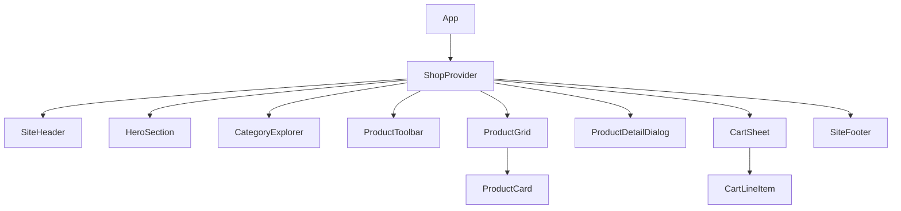
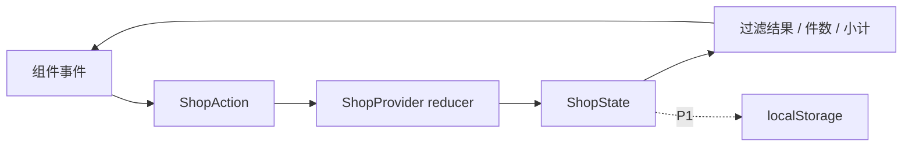

# Wayfarer Supply 技术设计文档

**版本：** 1.0
**状态：** 方案
**依据：** [PRD](./PRD.md) · [UI 设计文档](./UI-DESIGN.md)
**技术目标：** 50 分钟内实现可演示的多品类 React 商店，核心选购流程完整，桌面和手机均可用。

## 1. 技术决策摘要

| 层 | 选择 | 选择原因 |
|---|---|---|
| 应用框架 | React + TypeScript + Vite | 快速启动单页应用；类型约束让商品、语言和购物车数据结构清楚。 |
| UI 基础 | shadcn/ui + Tailwind CSS | 直接获得可自定义的 React 组件源码与响应式样式基础，适合快速实现 Dialog、Sheet、Button、Input 等交互。 |
| 图标 | Lucide React | 线性图标风格统一，适合搜索、购物车、数量和关闭操作。 |
| 状态 | React Context + `useReducer` | 本项目状态规模小、数据本地模拟，无需引入额外状态库。 |
| 商品数据 | TypeScript 静态数据 | 8–10 件商品、5 个一级类目，无 API 或数据库依赖。 |
| 国际化 | 本地类型化文案字典 | 仅支持英语和简体中文，避免为轻量演示项目引入大型 i18n 配置。 |
| 持久化 | `localStorage`（P1） | 可选保存语言与购物车；核心功能在存储不可用时仍能运行。 |
| 动效 | Tailwind 状态类 + CSS keyframes | 实现动态网格、霓虹边框和按钮反馈，避免 WebGL、Canvas 或动画运行时依赖。 |
| 部署 | 静态站点托管 | Vite 构建产物为静态资源，不需要服务端或环境密钥。 |

shadcn/ui 当前提供 Vite + React + TypeScript 的安装路径，Tailwind CSS 也可通过 Vite 插件接入；组件由 CLI 加入项目，样式与组件源码留在仓库中，方便按霓虹视觉直接定制。[shadcn/ui Vite 安装指南](https://ui.shadcn.com/docs/installation/vite)

## 2. 范围与关键非目标

### 本次实现

- 单页商店，无登录、后端或真实支付。
- 5 个一级类目：Bags、Travel、Tech、Drinkware、Everyday Carry。
- 8–10 个本地商品，支持搜索、类目筛选、商品详情、加购和购物车数量编辑/删除。
- 英语默认、简体中文可切换；所有主要界面和商品文案双语。
- 深色霓虹主题、动态网格和强动效，并提供减少动态效果模式。
- 桌面、平板和窄屏手机响应式布局。

### 不实现

- API、真实库存、订单、结账或支付。
- 用户登录、云同步、多币种、其它语言。
- 路由框架、服务端渲染、状态管理库、复杂动画库。

## 3. 应用结构

```text
src/
  app/
    App.tsx                 # 页面组合与布局
    ShopProvider.tsx        # 全局轻量状态与 actions
  components/
    layout/
      SiteHeader.tsx
      HeroSection.tsx
      CategoryExplorer.tsx
      SiteFooter.tsx
    catalog/
      ProductToolbar.tsx
      ProductGrid.tsx
      ProductCard.tsx
      ProductDetailDialog.tsx
    cart/
      CartSheet.tsx
      CartLineItem.tsx
    ui/                     # shadcn/ui 生成并按需定制
  data/
    products.ts             # 8–10 件双语模拟商品
  i18n/
    messages.ts             # en / zh-CN UI 字典与类型
  lib/
    currency.ts             # 美元格式化
    product-selectors.ts    # 搜索、筛选、排序与购物车派生值
    storage.ts              # localStorage 安全读写
    utils.ts                # shadcn 常用 cn() 等工具
  types/
    shop.ts                 # Locale、Product、ShopState、Action
  index.css                 # CSS 变量、霓虹 tokens、动态网格 keyframes
  main.tsx
```

该目录是便于维护的目标结构。50 分钟实现时可将小组件合并到少数文件中，但保留 `data`、`i18n`、`types` 和状态逻辑的职责边界。

### 组件树



## 4. UI 组件选型与使用边界

shadcn/ui 是项目内可定制组件源码；通过 CLI 只添加本次会用到的组件，避免一次生成整套 UI。

| 交互 | 建议组件 | 说明 |
|---|---|---|
| 主/次行动 | `Button` | 用 variant / className 实现黄绿主按钮、霓虹描边次按钮。 |
| 搜索 | `Input` | 配合搜索图标、清除按钮和清晰 focus ring。 |
| 购物车抽屉 | `Sheet` | 用于右侧桌面抽屉；手机端改为全屏高度。 |
| 商品详情 | `Dialog` | 提供键盘焦点管理、Esc 关闭和遮罩行为。 |
| 商品信息标签 | `Badge` | 类目、评分、新品等短标签。 |
| 排序（P1） | `Select` | 原生清晰的键盘/触屏选择。 |
| 提示 | `Sonner` 或内联状态 | 只在加购等操作后短暂提示，不用阻断式弹窗。 |
| 分隔线/加载占位 | `Separator` / `Skeleton` | 可按实现时间选用；静态本地数据通常不需要加载占位。 |

使用 shadcn/ui CLI 选择一个基础组件实现（Base UI 或 Radix）并保持一致，不在同一交互中混用两套底层 primitive。图标按钮需包含 `aria-label`；装饰性发光和网格使用 `aria-hidden="true"`。

## 5. 领域类型与模拟数据

```ts
export type Locale = "en" | "zh-CN";
export type CategoryId =
  | "bags"
  | "travel"
  | "tech"
  | "drinkware"
  | "everyday-carry";

export type LocalizedText = Record<Locale, string>;

export interface Product {
  id: string;
  name: LocalizedText;
  categoryId: CategoryId;
  description: LocalizedText;
  alt: LocalizedText;
  priceUsd: number;
  rating: number;
  reviewCount: number;
  imageUrl: string;
  badge?: LocalizedText;
}
```

- 商品 ID 和 `categoryId` 稳定，不使用翻译后的名称作为筛选键。
- 数据至少覆盖 4 类，理想状态覆盖全部 5 类；每个商品提供英文/简体中文 name、description、alt 和 badge。
- 图片可以使用项目内静态文件或公开图片 URL；图片失败时显示带商品名的替代底板，不让卡片塌陷。
- 金额使用数字 USD 保存，格式化只在展示时进行；不得用浮点格式化后的字符串参与运算。

## 6. 状态管理与核心业务逻辑

### 状态归属

```ts
interface ShopState {
  locale: Locale;
  searchQuery: string;
  selectedCategory: CategoryId | "all";
  sortBy: "featured" | "price-asc" | "price-desc";
  selectedProductId: string | null;
  isCartOpen: boolean;
  cartQuantities: Record<string, number>; // productId -> quantity
}
```

- `ShopProvider` 使用 `useReducer` 持有共享状态和明确 actions。
- 搜索输入的临时输入状态可留在 `ProductToolbar`；提交或每次输入后同步 `searchQuery`。
- 详情弹窗用 `selectedProductId` 控制，避免在全局状态重复存放商品对象。
- 购物车只存商品 ID 和数量；名称、价格从唯一商品数据源派生，避免信息重复和价格漂移。
- 商品总件数、购物车行项目、小计、筛选结果全部通过 selector 派生，不额外存储可计算状态。

### Actions

```ts
type ShopAction =
  | { type: "locale/set"; locale: Locale }
  | { type: "search/set"; query: string }
  | { type: "category/set"; categoryId: CategoryId | "all" }
  | { type: "sort/set"; sortBy: ShopState["sortBy"] }
  | { type: "product/open"; productId: string }
  | { type: "product/close" }
  | { type: "cart/open" }
  | { type: "cart/close" }
  | { type: "cart/add"; productId: string; quantity?: number }
  | { type: "cart/quantity"; productId: string; quantity: number }
  | { type: "cart/remove"; productId: string };
```

### 规则

1. 加购同一 ID 时累加数量；数量最低为 1。
2. 数量减到 1 后禁用减号；移除通过明确的删除按钮完成。
3. 商品结果为当前语言名称/类别/描述的大小写不敏感匹配；同时应用搜索和类目条件。
4. 切换语言保留搜索词、类别、排序、弹窗状态和购物车；商品标题/类别即时变为新语言。
5. 商品总件数为所有行数量之和；小计为 `sum(priceUsd * quantity)`。
6. 排序只在已筛选的商品上执行；排序为 P1，不影响 P0 搜索与筛选。

### 数据流



React 文档建议把多个组件共享且需同步变化的状态提升到最近的共同父层，并保持单一数据来源；这里由 `ShopProvider` 作为该边界，组件通过 props/actions 消费状态。[React：组件间共享状态](https://react.dev/learn/sharing-state-between-components)

## 7. 中英双语与金额格式化

- `messages.ts` 提供 `en` 和 `zh-CN` 的强类型字典；UI 组件通过 `t("key")` 或简单的 `messages[locale].key` 取文案。
- 商品文案直接保存在 `Product` 的双语字段，不在运行时调用机器翻译。
- 类别显示名称从 locale 字典映射，筛选状态始终使用稳定的 `CategoryId`。
- `document.documentElement.lang` 根据语言更新为 `en` / `zh-CN`。
- 金额统一 USD：

```ts
export function formatUsd(amount: number, locale: Locale) {
  return new Intl.NumberFormat(locale === "zh-CN" ? "zh-CN" : "en-US", {
    style: "currency",
    currency: "USD",
  }).format(amount);
}
```

- 中文 UI 的价格应明确呈现为 `US$24.00`；若运行时格式器与此显示不一致，使用明确的美元前缀格式化函数。
- 缺少某一语言的文案属于开发期类型/数据错误；不能静默输出 `undefined` 或混合两种语言。

## 8. 霓虹主题、动效与响应式实现

### 样式技术

- Tailwind CSS 用于布局、断点、间距和常规交互状态；CSS variables 定义 Void、Violet、Cyan、Magenta、Lime 等设计 token。
- `index.css` 定义动态网格、光场呼吸、边框流光、标题揭示和 marquee keyframes。
- shadcn/ui 组件通过 `className` 和 CSS variables 覆盖成深色主题；避免在业务 JSX 中堆叠很长的重复霓虹类名，重复样式提取成组件/utility。
- 动画优先只改变 `transform` 和 `opacity`；避免大面积实时 `filter: blur()`、布局属性动画或对每张卡片无限叠加动画。
- 用 `motion-safe:` / `motion-reduce:` 或 `@media (prefers-reduced-motion: reduce)` 控制动态模式。Tailwind 官方提供相应变体用于为减少动态偏好提供不同样式。[Tailwind 动画与减少动态效果](https://tailwindcss.com/docs/animation)

### 响应式规则

- 桌面：导航全显；品类入口横向铺排；商品网格 3–4 列；购物车为约 400–460 px 右侧 Sheet。
- 平板：导航可减少文字；商品网格 2–3 列；详情仍用 Dialog/宽面板。
- 手机（360–430 px）：导航收束但不隐藏语言和购物车；品类入口 2 列；商品网格 1–2 列；详情和购物车 Sheet 接近全屏。
- 页面不产生横向滚动；购物车列表在面板中独立滚动，底部小计/CTA 固定可见。
- `prefers-reduced-motion` 下关闭网格移动、滚动字带、常驻流光和大幅位移，保留静态纹理、颜色状态和短暂淡入反馈。

## 9. 本地持久化与失败处理

持久化为 P1；P0 浏览器内存状态必须独立可用。

- 保存 key 建议 `wayfarer-shop:v1`，内容仅含 `locale` 和购物车 `{ productId, quantity }` 数组。
- 页面初始化时读取并校验版本、locale、商品 ID 和数量；过滤失效商品或非正整数数量。
- `localStorage` 读写使用 `try/catch`；隐私模式或配额异常时回退内存状态，不阻塞页面。
- 不保存个人信息、地址、支付数据或用户输入的敏感内容。
- 图片 onError 切换本地 placeholder；图片请求不得使搜索/商品卡功能失败。

## 10. 无障碍、安全与性能

- 使用原生按钮、输入框和列表语义；键盘可触达分类、搜索、购物车、数量和关闭入口。
- Sheet/Dialog 需有可读标题、Esc 关闭、焦点管理和关闭后的焦点回归；图标按钮提供标签。
- 商品图片提供当前语言的 `alt`；纯装饰网格/光晕标记为 `aria-hidden`。
- 霓虹 glow 不用于承载文字；文本与底色有清楚对比；状态不能只依靠颜色表达。
- 无后端不等于可执行 HTML：模拟商品描述只按文本渲染，不用 `dangerouslySetInnerHTML`。
- 不包含密钥，不请求用户资料；公开图片链接按非可信资源处理并配置错误占位。
- 复杂背景只用 CSS 图层，使用 `pointer-events: none`、`aria-hidden`，避免覆盖点击区。

## 11. 项目初始化与运行约定

建议新建 Vite React + TypeScript 项目后接入 shadcn/ui，按实际使用添加组件。官方 Vite 配置包含 Tailwind Vite 插件和 `@/*` 路径别名；项目应提交 lockfile 以固定本次依赖解析结果。[shadcn/ui Vite 安装步骤](https://ui.shadcn.com/docs/installation/vite)

```bash
npx shadcn@latest init -t vite
# 按提示选择项目名 wayfarer-supply 和 React + TypeScript
cd wayfarer-supply
npx shadcn@latest add button input badge dialog sheet select separator sonner
npm run dev
```

建议保留常用命令：

```bash
npm run dev       # 本地开发
npm run build     # 生成静态产物到 dist
npm run preview   # 本地预览构建结果
```

该方式由 shadcn CLI 创建并配置 Vite 项目；如果改为先用 Vite 脚手架创建空项目，则需按官方 Existing Project 指引单独配置 Tailwind 插件和 `@/*` 路径别名后再执行 `shadcn init`。具体 CLI 选项和组件名称以初始化时的官方文档为准。[Vite 模板与 shadcn/ui](https://ui.shadcn.com/docs/installation/vite)

## 12. 50 分钟实现顺序

| 时间 | 范围 | 完成标志 |
|---|---|---|
| 0–5 分钟 | Vite React TS 启动、shadcn/ui 初始化、全局 tokens | 开发服务器运行，基础主题可见 |
| 5–12 分钟 | 类型、双语字典、商品静态数据、站点骨架 | 首页可展示 8–10 个多品类商品 |
| 12–22 分钟 | 品类入口、搜索、筛选、商品卡片和基础霓虹主题 | 可以查找并浏览商品 |
| 22–32 分钟 | 详情 Dialog、数量选择、购物车 reducer/Sheet | 商品可加入购物车且金额正确 |
| 32–40 分钟 | 中英切换、空状态、响应式及核心交互收尾 | 核心选购闭环完成 |
| 40–45 分钟 | 动态网格、主视觉揭示、动效降级和溢出修复 | 确认强动效不遮挡操作 |
| 45–50 分钟 | 本地构建、README/交付说明；有余力时部署 | 源码可启动、静态构建可交付 |

**降级顺序：** 时间不足时保留 P0 搜索、分类、加购、购物车、中英文和响应式；将排序、localStorage、第二张图、卡片持续流光和复杂动效优先延后。动态网格可用一层 CSS 背景完成，不引入额外动画引擎。

## 13. 技术验收标准

- [ ] `npm run dev` 可启动，`npm run build` 可生成静态产物。
- [ ] TypeScript 商品类型覆盖双语文案、稳定类目 ID、美元数值、图片 alt。
- [ ] 搜索和类别筛选可同时使用；切换语言保留搜索、类目和购物车。
- [ ] 重复加购同一商品累加数量；购物车增减/删除后件数与小计正确。
- [ ] 购物车/详情面板支持键盘关闭，并有明确标题、焦点和标签。
- [ ] 在 1440、768、390、360 px 目标宽度下无页面横向溢出，主要购物控件可操作。
- [ ] 动态网格、霓虹光效与首屏动效正常；打开减少动态效果后持续动画被关闭。
- [ ] 图片失败时有占位，不影响列表布局和商品选择。
- [ ] `localStorage` 无法访问时仍可搜索、加购和调整购物车。
- [ ] 页面不包含真实支付入口、后端密钥或敏感数据。

以上为验收目标，当前文档未执行应用实现或浏览器验证。
